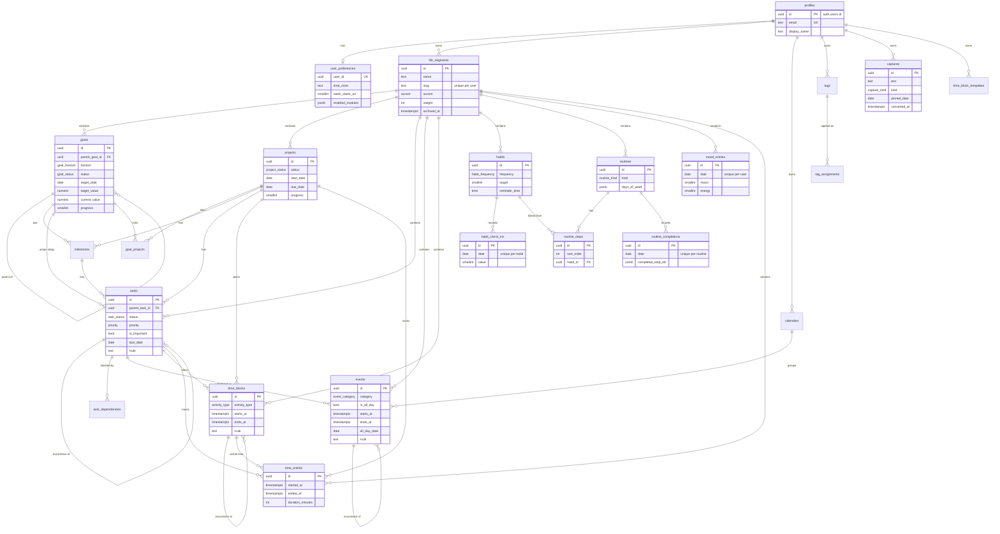

# Database schema

Release 0 covers Identity, Organisation, Planning, Scheduling, Tracking and the
Capture inbox from instructions.md Phase 5. Later releases add Faith, Learning,
Wellness, Lifestyle, Food, Inspiration, Finance, Work and Resources.

Source of truth: `src/db/schema/*.ts` (Drizzle). Generated SQL lives in `drizzle/`.

## Where the schema lives

All tables and enums are created in the `planner` Postgres schema of the planner's own Supabase projects (`docs/decisions/0002`). `src/db/schema/_schema.ts` exports the `pgSchema('planner')` object every file uses. `drizzle.config.ts` sets `schemaFilter: ['planner']` and keeps the migration journal in `planner.__drizzle_migrations`, so `push`, `generate` and `migrate` never touch the `public` schema. The profile trigger is `planner_on_auth_user_created` → `planner.handle_new_user()`, and the migration backfills profiles for auth users that already exist.

## Conventions (instructions.md 5.2)

- Primary keys are `uuid` with `gen_random_uuid()`. `profiles.id` is the Supabase
  `auth.users` id, written by the `on_auth_user_created` trigger
  (`drizzle/0001_auth_profile_trigger.sql`).
- Every user-owned table has `user_id → profiles.id (cascade)`, `created_at`,
  `updated_at` (timestamptz, `updated_at` set by Drizzle on update) and a
  composite index on `(user_id, …)` for its common queries.
- Row-level security is enabled on every table with four policies per table
  (`<table>_select/insert/update/delete`, `auth.uid() = user_id`; `profiles` uses
  `auth.uid() = id`). They come from `ownerPolicies()` in
  `src/db/schema/_policies.ts`. The app connects directly with `DATABASE_URL`
  and filters by `user_id` explicitly; RLS is the second line of defence.
  `drizzle-kit push` drops policies that are not declared in code.
- Soft deletion through `deleted_at` on user-facing content (goals, projects,
  tasks, events, time blocks, habits, routines). Hard delete only cascades from
  account deletion.
- Enums for status, priority, horizon, kind, accent. No free-text status.
- Money columns are `numeric(14,2)`; use `decimal.js` for arithmetic.
  Durations are integer minutes.
- Instants are `timestamptz`. Date-only facts (habit check-ins, mood entries,
  due dates, all-day events, routine completions) are `date` in the user's time
  zone from `user_preferences.time_zone`.
- Recurrence (`rrule`, `dtstart`, `until`, `exdates`, `occurrence_date`,
  `recurrence_parent_id`) is a column set on tasks, events and time blocks from
  `recurrence()` in `src/db/schema/_columns.ts`. Rules are RFC 5545 strings
  expanded on read; a row is materialised only when an occurrence is completed,
  edited or moved.

## Life Segment rules (instructions.md 5.3) in Release 0

| Rule                                             | Tables                                                                                                      |
| ------------------------------------------------ | ----------------------------------------------------------------------------------------------------------- |
| `life_segment_id` required, `on delete restrict` | goals, projects, tasks, events, time_blocks, habits, routines, mood_entries, time_entries                   |
| Exempt (reference or library records)            | profiles, user_preferences, life_segments, tags, tag_assignments, calendars, time_block_templates, captures |
| Inherit the segment from their parent            | milestones, goal_projects, task_dependencies, routine_steps, routine_completions, habit_check_ins           |

`life_segments.weight` is the analytics weight. Archiving sets `archived_at`;
deleting a segment fails while records reference it, so they must be moved first.

## Entity relationship diagram

## Legacy import tables (Release 1)

- `legacy_import_files`: the raw JSON export of the old app, stored once per upload with a summary, so later releases can import the sections Release 1 defers (Bible studies, studies, recipes, meal plan, journal, quotes) without asking for the file again.
- `legacy_map`: `(user_id, entity_type, legacy_key) → new_id`, which makes re-running an import skip records it already created.

## Release 3 tables

- Faith: `bible_books` (reference data, 73 rows inserted by migration 0005, no RLS), `scripture_references`, `bible_studies`, `bible_study_notes`, `reading_plans`, `reading_progress`, `prayer_entries`, `devotional_entries`. Passages are stored as references only; Bible text is never stored.
- Learning: `subjects`, `courses`, `lessons`, `study_sessions` (optionally linked to a time entry), `study_notes`, `assignments` (optionally mirrored as a task), `learning_resources`.
- Reflection: `journal_entries` (kind daily, gratitude, wellness, reflection), `reviews` (kind weekly, monthly, quarterly, annual, goal; answers keyed by prompt).
- Media: `media_items` (segment optional, a library record), `media_logs` (segment required), `media_lists`, `media_list_items`.
- Resources: `notes` (kind note or quote).

## Working with the schema

First time on a project: run `db:migrate` before any `db:push`. drizzle-kit's `schemaFilter` keeps the `planner` schema itself out of its snapshot, so `push` does not create it; the first migration does (`CREATE SCHEMA IF NOT EXISTS "planner"`), as does the migrator for its journal. If you must start with `push`, create the schema once in the SQL editor: `create schema if not exists planner;`.

| Task                             | Command                                             | Notes                                                                    |
| -------------------------------- | --------------------------------------------------- | ------------------------------------------------------------------------ |
| Change the schema                | edit `src/db/schema/*.ts`                           | add new domain files to the `schema` list in `drizzle.config.ts`         |
| Push to the dev project          | `npm run db:push:dev`                               | reads `DIRECT_URL` from `.env.local.dev`; dev only (instructions.md 5.4) |
| Generate a migration             | `npm run db:generate -- --name=<change>`            | offline; commit `drizzle/*.sql` and `drizzle/meta/`                      |
| Custom SQL (triggers, functions) | `npx drizzle-kit generate --custom --name=<change>` | then fill the empty file                                                 |
| Apply migrations to prod         | `npm run db:migrate`                                | reads `DIRECT_URL` from `.env.local`; run from CI                        |
| Browse data                      | `npm run db:studio` / `npm run db:studio:dev`       |                                                                          |
| Seed development data            | `SEED_USER_ID=<auth user uuid> npm run db:seed`     | idempotent; the user must have signed in once                            |

Never edit an applied migration. The two shipped migrations are
`drizzle/0000_init.sql` (all tables, enums, indexes, RLS policies) and
`drizzle/0001_auth_profile_trigger.sql` (`handle_new_user()` and the
`on_auth_user_created` trigger).
